# goit-rdb-fp

Фінальний проєкт з курсу реляційних баз даних (GoIT Neoversity). Я завантажую дані про інфекційні захворювання в PostgreSQL у схему `pandemic`, нормалізую таблицю до 3НФ, рахую статистику `Number_rabies`, будую різницю в роках вбудованими функціями і пишу дві власні SQL-функції.

## Датасет

`infectious_cases.csv` з умови проєкту ([Google Drive](https://drive.google.com/file/d/1dQf-uVXzYPYYGgXsG1y4Q1qDdhP2miZl/view?usp=drive_link)). У ньому кількість випадків дев'яти інфекційних хвороб за країнами, регіонами й роками, 1920-2023: 10 521 рядок, 12 колонок. Копія лежить у `data/infectious_cases.csv`. Якщо файлу немає, notebook сам качає його з Google Drive.

## Таблиці в схемі `pandemic`

| Таблиця | Рядків | Що це |
|---|---|---|
| `infectious_cases` | 10 521 | сирий імпорт CSV через `COPY`, усі колонки `TEXT` |
| `entities` | 245 | довідник `id`, `entity`, `code`; у 34 entity без коду ISO (переважно регіони й групи країн) `code` дорівнює `NULL` |
| `infectious_cases_normalized` | 10 521 | показники з `entity_id`, роком і числовими типами, `UNIQUE (entity_id, year)` |

Функції: `years_since(year)` і `avg_cases_per_period(cases_per_year, divisor)`.

## Де що

| Завдання | Розділ notebook | Скриншоти |
|---|---|---|
| 1. Схема й імпорт | Завдання 1: `CREATE SCHEMA`, `SET search_path`, `CREATE TABLE`, `COPY`, огляд і профіль колонок | `01`-`04` |
| 2. Нормалізація до 3НФ | Завдання 2: DDL, `INSERT ... SELECT`, кількості, перевірка без втрат, чому це 3НФ | `05`-`07` |
| 3. `Number_rabies` | Завдання 3: `AVG`/`MIN`/`MAX`/`SUM`, топ-10 за середнім, навіщо `WHERE`, топ серед країн | `08` |
| 4. Різниця в роках | Завдання 4: `MAKE_DATE`, `CURRENT_DATE`, `AGE` | `09` |
| 5. Власні функції | Завдання 5: `years_since`, `avg_cases_per_period` з дільниками 12, 4, 2 | `10`-`11` |

## Скриншоти

### 1. Схема `pandemic`
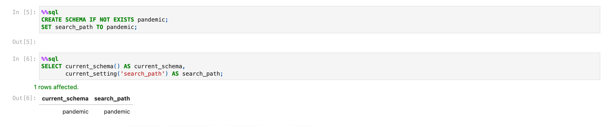

### 1. Імпорт `infectious_cases`
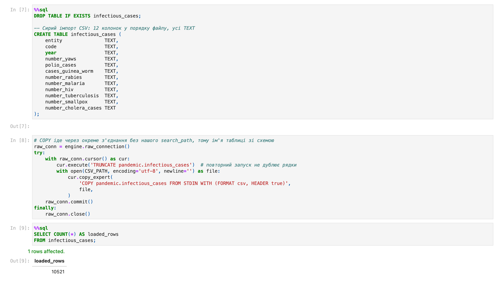

### 1. Огляд даних
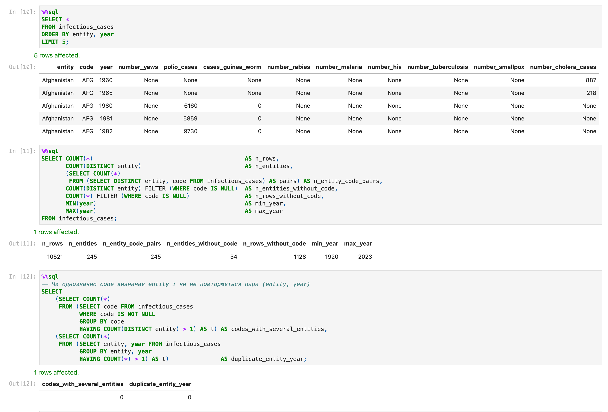

### 1. Профіль колонок
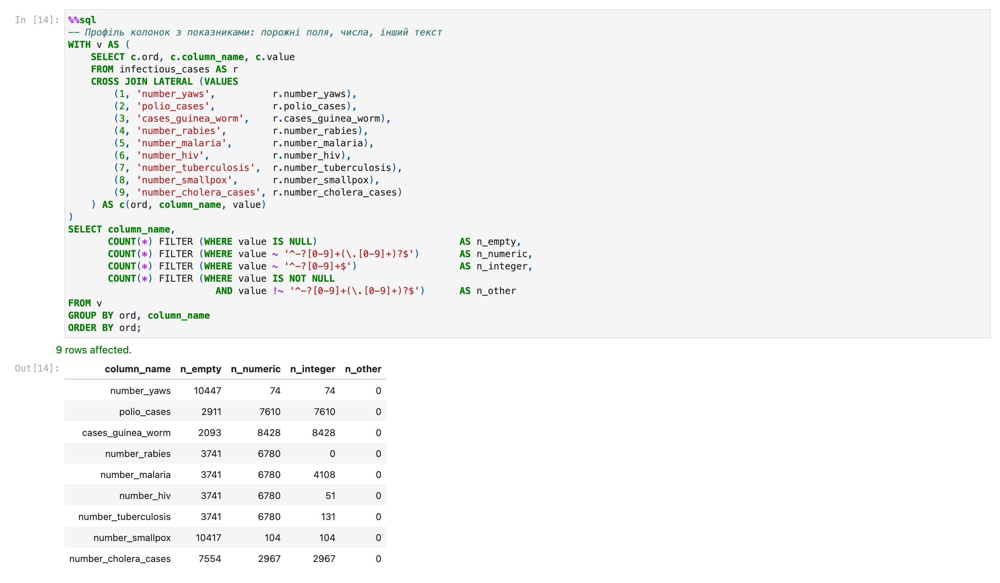

### 2. DDL і заповнення нормалізованих таблиць
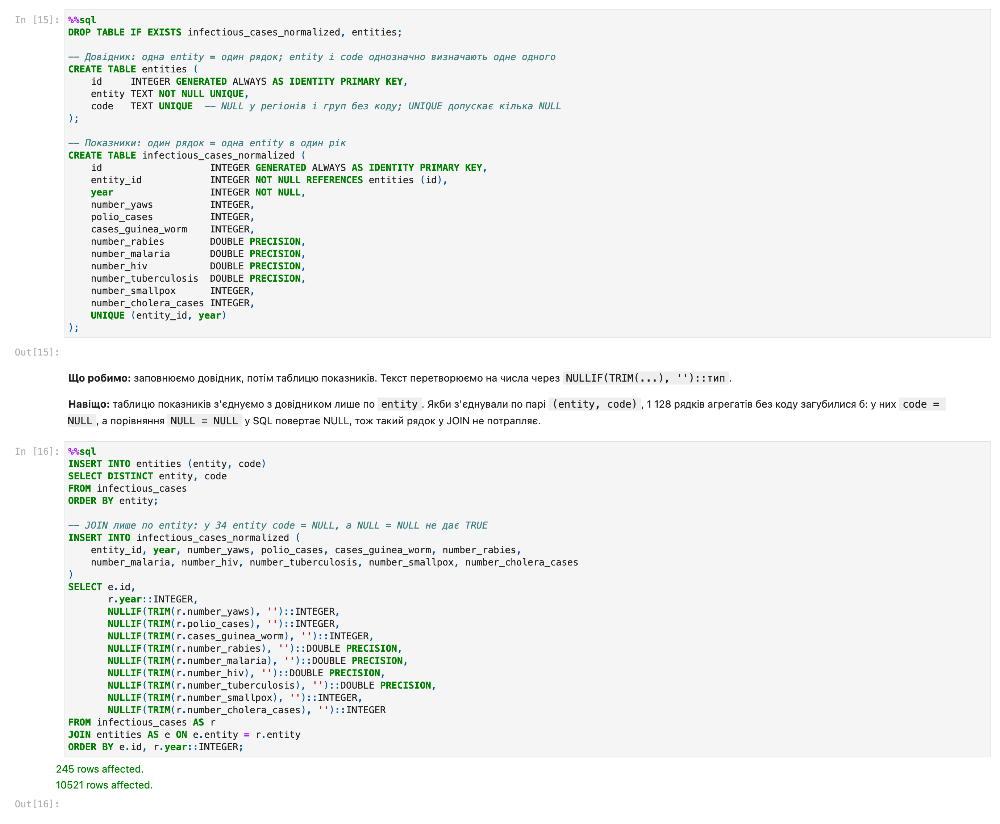

### 2. Нормалізовані таблиці
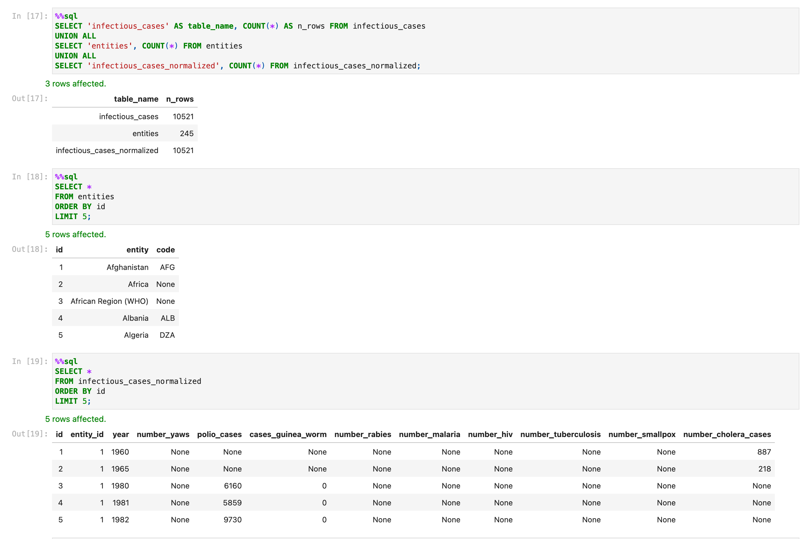

### 2. Перевірка без втрат
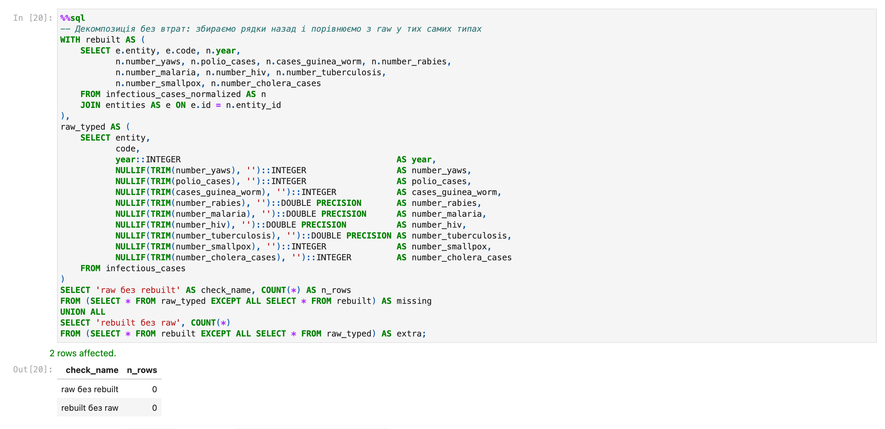

### 3. Топ-10 за середнім `number_rabies`
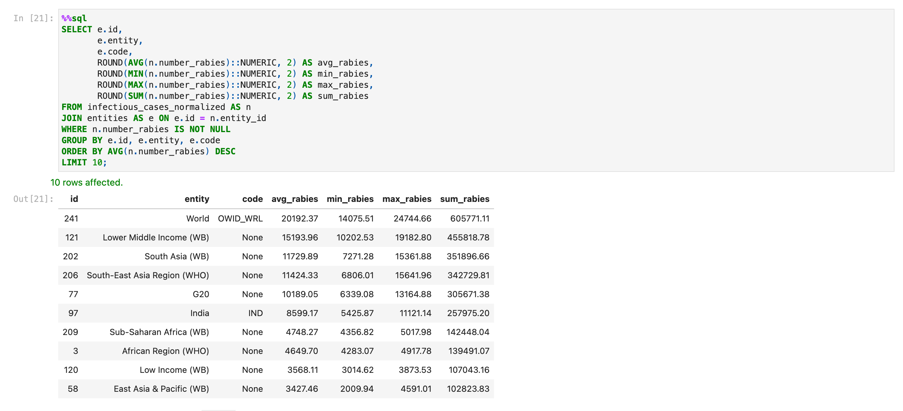

### 4. Різниця в роках
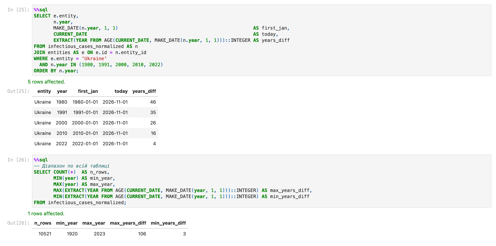

### 5. Функція `years_since`
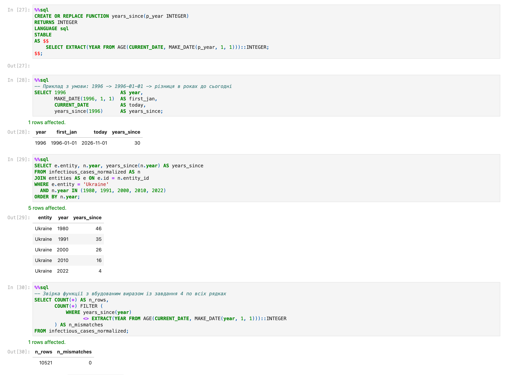

### 5. Функція `avg_cases_per_period`
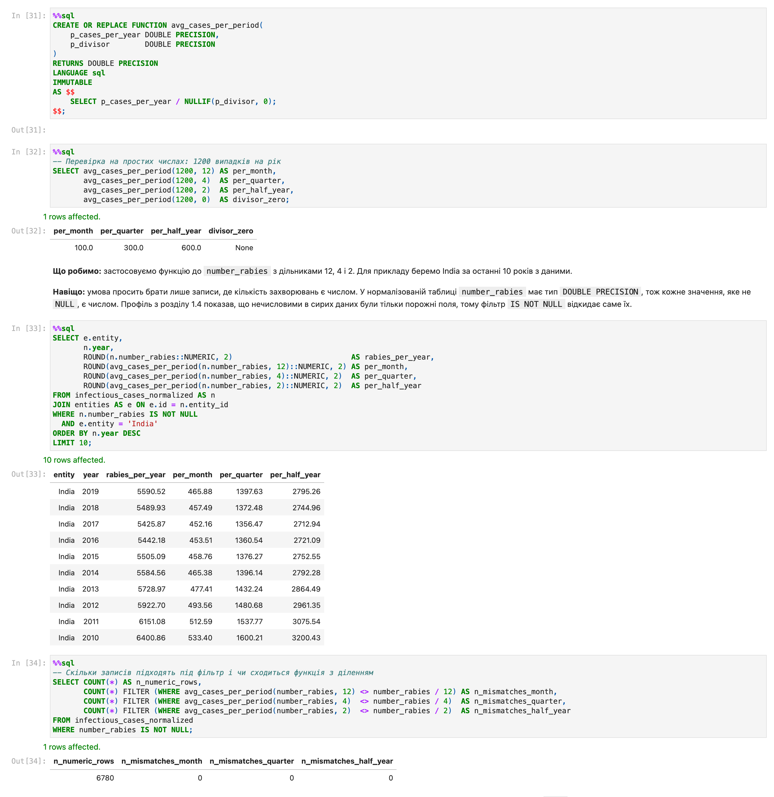

## Як запустити

**Google Colab:** відкрити `RDB_FINAL_PROJECT.ipynb`, далі Runtime → Run all. Перша клітинка ставить `pixeltable-pgserver==0.4.0`, `psycopg2-binary`, `sqlalchemy` і `jupysql`. PostgreSQL 16 запускається прямо в runtime, окремий сервер не потрібен. Оригінальний пакет `pgserver` на поточній версії Python у Colab не встановлюється, а цей форк має той самий API.

**Локально:** потрібен [uv](https://docs.astral.sh/uv/).

```bash
uv venv --python 3.12 .venv
uv pip install --python .venv/bin/python jupyter nbconvert ipykernel pip
.venv/bin/jupyter nbconvert --to notebook --execute --inplace --ExecutePreprocessor.timeout=600 RDB_FINAL_PROJECT.ipynb
```

`pip` у venv потрібен, бо перша клітинка ставить пакети через `%pip install`.

**Лише SQL:** `final_project.sql` містить увесь SQL з notebook у тому ж порядку. Його запускають через psql з кореня репозиторію, CSV вантажить `\copy`:

```bash
psql -v ON_ERROR_STOP=1 -d <база> -f final_project.sql
```

Повторний запуск безпечний: таблиці створюються наново, функції замінюються через `CREATE OR REPLACE`.

## Файли

| Файл | Що всередині |
|---|---|
| `RDB_FINAL_PROJECT.ipynb` | notebook з усіма завданнями, output і поясненнями |
| `final_project.sql` | увесь SQL проєкту одним файлом |
| `data/infectious_cases.csv` | датасет |
| `screenshots/` | 11 скриншотів запитів і результатів |
| `README.md` | цей опис |
| `.gitignore` | службові файли й локальні нотатки |
